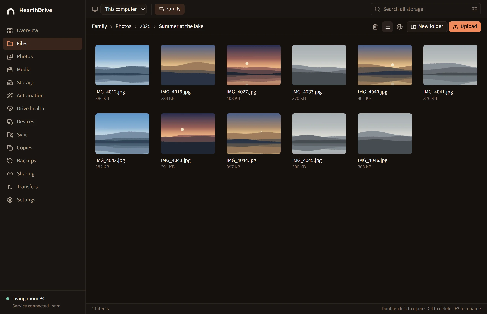
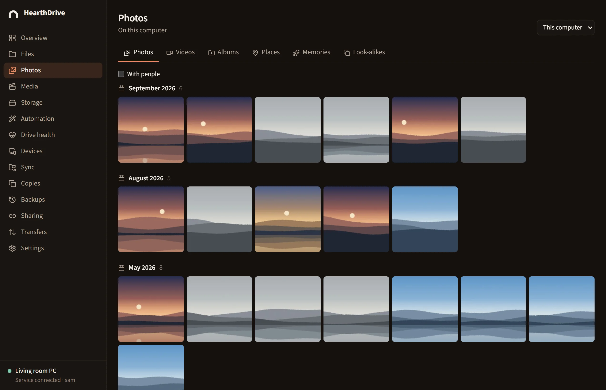
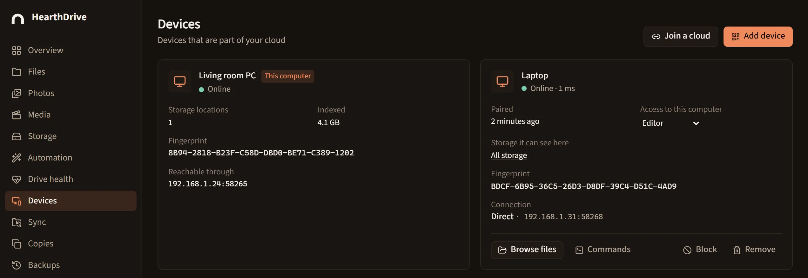
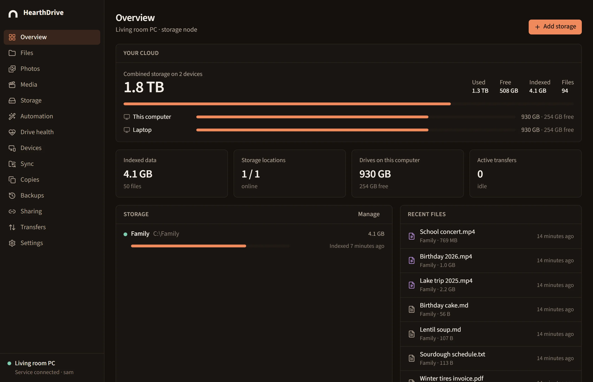
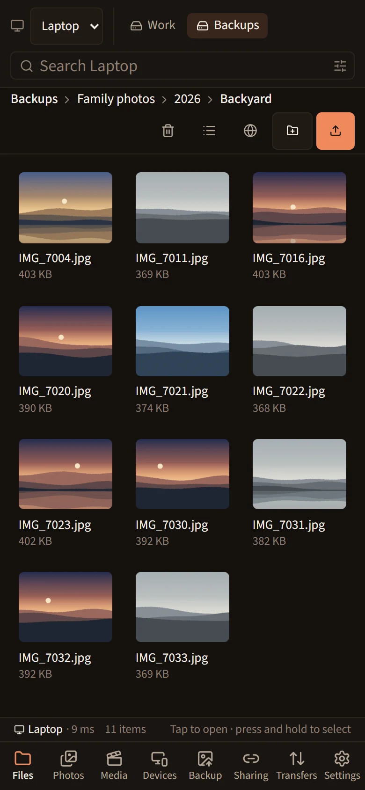

<div align="center">

# HearthDrive

**Your devices. Your storage. One cloud.**

A private, self-hosted personal cloud made of your own Windows computers and Android phones.<br>
Free and open source. No subscription, no third-party storage, nothing exposed to the public internet.


**[Website](https://mohdjey123.github.io/hearthdrive/)** · **[Download](../../releases/latest)** · [Release notes](docs/releases)

</div>

---

> HearthDrive was called **NEXUS Cloud** up to version 0.1.5. Updating keeps everything: devices, pairings, settings, the data folder and the install folder stay as they were, and the old name's shortcuts are renamed.

Every computer you install HearthDrive on becomes a storage node: it indexes the folders and drives you choose (in place, nothing is moved or uploaded anywhere) and serves them to your other devices. Devices pair with a link or a QR code and talk over end-to-end encrypted peer-to-peer connections, from any network, with nothing else to install.



<table>
<tr>
<td width="50%"></td>
<td width="50%"></td>
</tr>
<tr>
<td>Photos from every folder you added, by month</td>
<td>Paired devices, whether they are online and how they connect</td>
</tr>
<tr>
<td></td>
<td align="center"></td>
</tr>
<tr>
<td>Storage across all your devices, and recent files</td>
<td>The Android app, browsing photos kept on the laptop</td>
</tr>
</table>

The screenshots show two demo computers with sample files.

> **Status:** Phases 0–6 are done: storage nodes, pairing, browsing and search across devices, copies, folder sync with versions, per-device and per-person access, encrypted share links, the Android app with photo backup, and updates that spread between your own devices. On top of that: photos, music and films, searchable documents, rules, WebDAV and S3 access, encrypted folders and plugins. A store-signed Android build is next (see [Roadmap](#roadmap)).

## Contents

- [Features](#features)
- [What works today](#what-works-today)
- [Repository layout](#repository-layout)
- [Development](#development)
- [Connecting your computers](#connecting-your-computers)
- [Working across devices](#working-across-devices)
- [Sync and versions](#sync-and-versions)
- [Backups](#backups)
- [Extra copies](#extra-copies)
- [Drive health](#drive-health)
- [Signing in safely](#signing-in-safely)
- [Phone backup and the share menu](#phone-backup-and-the-share-menu)
- [Shared folders and comments](#shared-folders-and-comments)
- [Share links](#share-links)
- [Photos, music and films](#photos-music-and-films)
- [Documents](#documents)
- [Rules and suggestions](#rules-and-suggestions)
- [File tools](#file-tools)
- [Programs, WebDAV and S3](#programs-webdav-and-s3)
- [Power and notifications](#power-and-notifications)
- [Updates](#updates)
- [Virtual drive](#virtual-drive)
- [Windows installer](#windows-installer)
- [Android app](#android-app)
- [Roadmap](#roadmap)

## Features

- **Your files stay where they are.** Add existing folders or whole drives; HearthDrive indexes them in place and never moves or copies them on its own.
- **One view of everything.** Browse, search, preview, stream, download and upload files on any of your devices from any other.
- **Built-in, encrypted networking.** Devices connect directly whenever possible and through an encrypted relay otherwise. No VPN, port forwarding or account with anyone.
- **Copy and sync between devices.** Background copies that resume after a dropped connection; one-way or two-way folder sync with conflict copies, a safety stop and version history.
- **Extra copies and drive health.** Keep a checked copy of a folder on one or more other computers, with removed files held back for a while; watch every disk's health and free space, and find and repair files a drive has silently damaged.
- **Your devices in File Explorer.** On Windows, every paired device's storage appears under **HearthDrive** in Explorer; files download when opened, like OneDrive.
- **Phone app.** The Android app runs the same node: browse your computers, back up photos and videos, and send files to a computer from any app's **Share** menu.
- **Share links.** Send anyone a link to a file or folder. With Send it is encrypted on your computer first, so the host never sees what it holds; links expire and can be limited to a number of downloads and protected with a password.
- **You decide who sees what.** Accounts with roles, per-device and per-person limits to chosen storage locations, and folders shared with chosen people and devices (to view, to edit, or only to add files), enforced on every device.
- **Comments.** Leave a note on any file for the others who can open it.
- **Photos, media and documents.** A photo timeline with a map, memories and look-alikes; music and films with resume on any device; search inside PDFs and Office files, scanned ones too, with automatic tags.
- **Rules, tools and other programs.** Rules that tag, sort, copy or clean up files by themselves; duplicates, archives, downloads from a link, encrypted folders and plugins; WebDAV, S3 and the API for other programs with their own tokens.
- **Updates from your own devices.** Publish a signed update on one computer and every paired computer and phone picks it up. Computers install it by themselves once their window is closed; phones ask first.
- **Built to be safe.** Loopback-only API, signed requests between devices, Argon2id passwords, two-step sign-in and passkeys, locking accounts and blocking lost devices, path validation against traversal and link escapes, and a security log.

## What works today

| Area | Implemented |
|---|---|
| Node | `nexus-service` background process that keeps running when the window closes; SQLite with migrations; daily rolling logs |
| Setup | First-run wizard: name the computer, create a local owner account (Argon2id), add folders or drives |
| Storage | Drive detection; add existing folders or whole drives (indexed in place, never moved); read-only roots; overlap and system-folder protection; removing a root never deletes files |
| Indexing | Fast metadata-only scan in 2,000-row batches; incremental rescans keep file ids stable; live filesystem watching; BLAKE3 hashes computed slowly in the background; drives that go offline keep their index and show as offline |
| Files | Unified browser (list and grid views), sort, multi-select, case-insensitive search across all storage, image/video/audio/text preview, HTTP range streaming, downloads, resumable uploads with progress and speed, new folder, rename, move, trash, restore, permanent delete, version history |
| Devices | Ed25519 identity per computer (private key encrypted with Windows DPAPI); pairing by link or QR code with a single-use 128-bit code, proof of key possession and owner approval after comparing fingerprints; per-device access role and storage limits; online/offline and latency monitoring; immediate removal on both sides |
| Networking | Built-in peer-to-peer networking ([iroh](https://iroh.computer)): QUIC connections dialed by device key, direct when possible (local network, NAT hole punching, UPnP), otherwise through an encrypted relay; public relays by default or your own; the HTTP API itself stays on loopback |
| Across devices | Browse, search, preview, stream, download, upload, rename, move and trash files on a paired device, relayed by your own node with signed requests; background copies of files and folders that resume after a dropped connection; pause, resume, run next and retry failed files; a shared speed limit, transfers at once and transfer hours; copies checked against the original's BLAKE3 hash |
| Sync | One-way and two-way folder sync between devices; conflict copies; removals go to the trash; a safety stop for mass removals; the last ten versions of every replaced file |
| Backups | Scheduled snapshots of a folder on a paired computer, each content stored once by BLAKE3; keep rules (latest, daily, weekly, monthly) with cleanup; stored contents read back and repaired; browse and restore any snapshot, beside or over the original; encrypted with a recovery key, and openable from another computer |
| Copies | A one-way, checked copy of a folder on one or more paired computers ("2 copies", "3 copies"); files removed here kept on the copy for a chosen time and brought back on request; copies read back weekly and repaired; a check for room before starting |
| Drive health | Windows' health verdict for every disk, with temperature, wear and error counts (asked of the disks directly when not running as administrator); free-space warnings; storage that goes missing or comes back; a monthly read of every file against its BLAKE3 hash to find silent damage, repaired from an extra copy or a backup; the same view of your other devices; a text report |
| Shared folders | A folder shared with people on a computer or with paired devices, on top of the storage they may see: view, edit, or add files only (a drop folder that shows nothing and never replaces a file); never beyond someone's role; follows the folder when HearthDrive renames or moves it; "Shared with you" in Files and on Sharing; groups of people (a family) to share with, and family spaces made in one step; upload links that let people without HearthDrive add files to a folder from your local network; comments on files for everyone who can open them |
| Share links | Links to a file or folder (sent as a zip) that anyone can open: end-to-end encrypted through [Send](https://github.com/timvisee/send) (AES-GCM, key only in the link) with expiry, a download limit and an optional password, or unencrypted through temp.sh for larger files; take a link down at any time; uploads appear under Transfers |
| Updates | Signed packages (Ed25519 over the version, size and BLAKE3 hash) passed between paired devices; computers keep packages for every platform to pass on; Windows installs by itself when its window is closed and nothing is copying, Android opens the system installer |
| People | Accounts with roles (owner, administrator, editor, viewer); per-person storage limits that also apply on paired devices; locked accounts; two-step sign-in turned off for someone who lost their phone |
| Sign-in | Two-step sign-in with an authenticator app (TOTP, RFC 6238; each code works once) and ten one-time recovery codes; passkeys (WebAuthn: Windows Hello, a phone or a security key; ES256, EdDSA and RS256 checked on the node); sessions listed with browser, sign-in method and last use, signed out one by one or all at once; the password and a code asked again before sensitive changes; wrong codes slowed down per account; a security log with refused sign-ins |
| Virtual drive | Paired devices' storage in File Explorer through the Windows Cloud Files API (no driver): folders listed on first open, files downloaded on read, Always keep on this device / Free up space, offline devices marked; edits, new files, renames, moves and deletes carried back to their device; this computer's own storage and folders shared with you; changes pushed within seconds; an offline cache with a size limit |
| Android | The same node inside the app; QR pairing; photo and video backup to a computer; HearthDrive in the system share menu |
| Security | Loopback-only API by default; per-run local token for the desktop app; sessions stored as token hashes; short-lived signed URLs for media; all paths validated against their root (traversal, reserved names, ADS, symlink and junction escapes); DNS-rebinding Host check; a strict Content Security Policy on the web interface; user content and everything shown from a paired device served with `CSP: sandbox`; origin check on the live event stream; per-person limits enforced on downloads too; blocked devices refused and sent nothing; phones accept first-run setup only from the app itself and keep their data out of Android backups; audit log |

## Repository layout

```
apps/desktop/          React + TypeScript UI (Vite, Tailwind) and the Tauri 2 shell (src-tauri/)
crates/
  nexus-common/        Shared types, errors, events, runtime discovery
  nexus-database/      SQLite access (SQLx); one database per node
  nexus-storage/       Storage roots, safe path resolution, file operations, drive detection
  nexus-indexer/       Scanner, filesystem watcher, background hasher, availability monitor
  nexus-security/      Argon2id, tokens, signed tickets, role checks
  nexus-network/       Peer-to-peer endpoint (iroh): device-key addressing, relays, connection cache
  nexus-devices/       Device identity keys (DPAPI), signed peer requests, replay guard, pairing links
  nexus-vdrive/        The virtual drive: a Windows Cloud Files sync root backed by the node
  nexus-api/           Axum REST + WebSocket API under /api/v1
  nexus-core/          Node lifecycle and the `nexus-service` binary
migrations/            SQL migrations (embedded at build time)
scripts/               Android build script
docs/                  Architecture and development notes
site/                  The website (GitHub Pages): plain HTML and CSS, published by .github/workflows/pages.yml
```

## Development

Prerequisites: Rust (stable), Node.js 20+, and the [Tauri Windows prerequisites](https://v2.tauri.app/start/prerequisites/) (WebView2 ships with Windows 11). End users need none of these.

```bash
npm install
```

Run the desktop app. This builds the service and starts Tauri with hot reload; the shell starts `nexus-service` automatically:

```bash
npm run desktop
```

Or run just the service and use a browser. The service serves the built UI at http://127.0.0.1:47100:

```bash
npm run build:ui
```

```bash
npm run service
```

Tests:

```bash
cargo test
```

Service options: `--data-dir`, `--port`, `--ui-dir` (or `NEXUS_DATA_DIR`, `NEXUS_PORT`, `NEXUS_UI_DIR`). Data defaults to `%LOCALAPPDATA%\HearthDrive` (`%LOCALAPPDATA%\NEXUS Cloud` on a computer that ran NEXUS Cloud before the rename, which keeps using it). It holds the database, logs, `runtime.json` and the encrypted device key (`identity.key`), never your files.

Networking options:

| Variable | Effect |
| --- | --- |
| `NEXUS_RELAY` | `default` (public relays run by the iroh project), `off` (direct connections only), or a comma-separated list of your own relay URLs |
| `NEXUS_P2P_PORT` | UDP port for peer-to-peer traffic (defaults to the API port, 47100; a random port is used if it is taken) |
| `NEXUS_NETWORK=local` | Development: the endpoint binds loopback only with no relay, so only nodes on this computer can connect (two nodes with different `--port` and `--data-dir` can pair) |
| `NEXUS_RELAY_ONLY=1` | Diagnostics: never use direct paths, to see what a device on a far-away network experiences |

## Connecting your computers

Nothing extra to install: each HearthDrive node connects to other nodes by itself.

1. Open **Devices** in HearthDrive on the first computer and choose **Add device**. **Connections** should say **Reachable from anywhere**.
2. On the second computer, choose **Join a cloud** (or **Join an existing cloud** during setup) and paste the link.
3. Back on the first computer, check that the fingerprint matches the one shown on the second, and approve.

Both computers can then browse each other from **Files** → device menu, from any network. Each keeps its own files and database. Each device card shows whether the connection is **Direct** or **Relayed**.

**Your other devices pair by themselves.** Pair each new device with one computer (your main node) and that computer introduces it to every other device it is paired with, and them to it, within about a minute. An introduced device is marked **Introduced by …** and is trusted no further than the device that introduced it: its role there is the lesser of the two, it sees only the storage the introducer sees, and it never introduces others in turn. Unpairing a device on the main node removes it from the others too; a device you remove by hand is not added again. Turn this off with **Devices** → **Pair my devices with each other** (this also removes the devices it added).

How it works: every connection is QUIC with TLS 1.3, authenticated with the two devices' own keys. Devices first try to connect directly. On the same network that always works; across the internet it usually works through NAT hole punching. When it doesn't (some corporate, hotel or mobile networks), traffic goes through a relay server. A relay only forwards encrypted packets and cannot read them. The free public relays are rate-limited, so large transfers over a relay are slow. If you often hit that, run your own [`iroh-relay`](https://docs.iroh.computer/relays) on a small server and start HearthDrive with `NEXUS_RELAY=https://relay.example.com`. The first time HearthDrive runs, Windows may ask whether to allow `nexus-service` through the firewall. Allow it on private networks; it only accepts connections from paired devices and pairing requests that carry a valid code.

## Working across devices

* **No waiting for a paired device.** Storage, folders and the device list of paired devices are remembered on screen, also after restarting the app, and refreshed in the background, so switching tabs shows them at once. They are forgotten when you sign out.
* **Search everywhere.** In **Files**, type a search and tick **All devices** to search this computer and every paired device that is online. Results say which device each file is on.
* **Copy between devices.** Select one or more files and choose **Copy to another device**. Pick the device, storage and folder. Folders are copied with everything inside them. The copy runs in the background (see **Transfers**); the content streams from the source to the destination through your node, nothing is stored in between, and a dropped connection continues from where it stopped.
* **Control transfers.** On **Transfers**, pause a copy, sync or backup and resume it later (each file continues from where it stopped), choose **Run next** to put a waiting one first, and **Retry what failed** to send only the files a copy could not. **Settings** there sets how many transfers run at once, a speed limit shared by all of them, and hours to transfer in (for example 22:00–07:00; outside them transfers wait and running ones pause). A copied file is checked against the original's BLAKE3 hash when the original has been hashed, sent once more if they differ, and counted as **checked**.
* **Limit what a device sees.** On **Devices**, each paired device shows **Storage it can see here**. Choose all storage or specific locations. Everything else is invisible to that device: it cannot list, search, download or upload there.
* **People.** Under **Settings** → **People**, an owner or administrator can add accounts (administrator, editor or viewer), change roles, lock accounts and remove people. People sign in from a browser on the computer itself (see [Signing in safely](#signing-in-safely)). The only owner cannot be removed or demoted.
* **Limit what a person sees.** Next to each editor or viewer, the storage button opens **What … can use**: all storage, or chosen locations on this computer and on your paired devices. Everything else is invisible to them, on every device, including in search, sync, transfers and the activity log. Owners and administrators always see everything. A change applies to their very next request.
* **Start with Windows.** **Settings** → **Start with Windows** starts HearthDrive in the system tray when you sign in, which also starts the storage service (a per-user start-up entry; no administrator rights). The tray menu shows what HearthDrive is doing and opens the HearthDrive folder, Transfers and Settings.

## Sync and versions

* **Sync a folder.** Open **Sync** → **New sync**, choose a folder here and a folder on a paired computer, and a direction: both ways, only to the device, or only from the device. Sync runs within about 20 seconds of a change here, every five minutes otherwise, and whenever you press **Sync now**.
* **Nothing is deleted outright.** A file removed on one side goes to the trash on the other. If a file changed on both sides, the newer one keeps its name and the other is kept beside it as `name (Device's copy date).ext`.
* **Safety stop.** If most of a folder disappears at once (an unplugged drive, a moved folder), sync does not remove the files on the other side. It says so on the Sync page; press **Sync now** if the removal was meant.
* **Earlier versions.** When sync, a copy or an upload with "replace" overwrites a file, the old content is kept (the last ten per file). Open **Properties** on a file to download or restore one. Restoring keeps the current content as a version too.
* **Resumable uploads.** Files over 8 MB are uploaded in pieces. If the connection drops, the upload continues where it stopped; choosing **Retry** (even after closing the app) picks up from there.

## Backups

Sync keeps folders the same; a backup keeps their **history**, so you can bring back what a folder held yesterday or last month, also after deleting or changing it on every device.

* **Set one up.** Open **Backups** → **New backup**, choose a folder here, a paired computer and a place on it, how often (every hour to every week) and which snapshots to keep: the latest few, and the newest of each of the last days, weeks and months (by default 7 latest, 14 daily, 8 weekly, 12 monthly).
* **What is stored.** On the other computer the backup gets a folder of its own (`<this computer> - <folder>`) holding each distinct file content once (`objects/ab/ab12…`), and one small file per snapshot listing every file's path, size, date and hash (`snapshots/<date>_<id>.nxb`). A file that did not change, or exists twice, is not sent or stored again. Snapshots that fall out of the keep rules are forgotten, and contents no kept snapshot uses go to that computer's trash.
* **Checked.** After every backup a sample of the stored contents is read back and compared with their hashes; **Check** (the shield) reads back everything. A damaged or missing content is sent again from this computer when it still has it, and the result shows on the backup.
* **Restore.** **Snapshots** lists every kept snapshot. Browse one, tick files or folders (or none for everything) and restore them **beside** the original (a new folder named `… (restored <date>)`) or **over** it (files that differ are replaced, each keeping its current content as a version). Every restored file is checked against its hash.
* **Encrypted.** New backups are encrypted (you can turn it off when setting one up). Every content and snapshot list is encrypted with ChaCha20-Poly1305 in 64 KiB chunks, so damage, reordering or a cut-off file is noticed, and contents are stored under keyed names that do not reveal their hashes. The backup's 256-bit key is kept on this computer protected for your Windows account (DPAPI). Unencrypted backups store contents under their plain BLAKE3 and snapshot lists as `.json`.
* **Recovery key.** When an encrypted backup is set up, HearthDrive shows its recovery key once (14 groups of four letters and digits, with a checksum against typing mistakes). Keep it away from this computer. The key icon on the backup shows it again after you enter your password.
* **Open a backup from another computer.** If the computer that made a backup is lost or set up again, open **Backups** → **Open a backup** on any computer paired with the device holding it: choose the device, the backup's folder there, a folder here to restore into, and enter the recovery key. Its snapshots appear, ready to browse and restore; it starts paused, and resuming it continues the backup from this computer into the same place.

## Extra copies

Sync keeps two folders the same both ways, and a backup keeps history in its own format. An **extra copy** is the simple middle: an ordinary folder on another computer that always holds what the folder here holds, so a failed drive or a stolen laptop does not take your files with it.

* **Keep a copy.** Open **Copies** → **Keep a copy**, choose a folder here, a paired computer and a place on it. HearthDrive checks there is room, copies everything over, and from then on copies new and changed files within a minute (every five minutes while nothing changes). **Add another** keeps a further copy on another computer; the page shows how many up-to-date copies each folder has.
* **Removed files are kept.** A file removed here is not removed from the copy straight away: it stays there for 30 days (7 days to a year, or not at all), listed under **… removed here are kept**, where you can **Bring back** any of it. After that it goes to that computer's trash. So a mistake here never wipes the copy too.
* **The copy follows this computer.** A file changed on the other computer is replaced by the one here (its content there kept as a version). Files that only exist on the other computer are left alone.
* **Checked.** Every copied file is checked against its BLAKE3 hash. Once a week part of the copy is read back and compared with the files here; **Check** reads all of it. A copy that no longer matches is sent again.
* **Not a backup.** A copy holds only the current files. For earlier versions of files, also set up a backup.

## Drive health

**Drive health** shows, for this computer and each paired one:

* **Disks.** Windows' own verdict for every physical disk (healthy, warning, failing), read every half hour, with temperature, wear, power-on hours and uncorrected errors. Without administrator rights HearthDrive asks the disks themselves (the NVMe health log, the drive's temperature and its own failure prediction), so most of this shows either way.
* **Free space.** A drive is *nearly full* under 10% free and *almost full* under 3% or 1 GB.
* **Missing storage.** Each storage location is looked at every minute. One that disappears (a drive unplugged or failing) is shown until it is back, and both events go into the activity log.
* **Silent damage.** Once a month (or when you press **Verify files**) HearthDrive reads every file of a storage location and compares it with the hash taken when it was indexed. A file whose content changed while its size and date did not was damaged on the disk. It is listed with where a good copy is (an extra copy or a backup); **Repair** puts the right content back and keeps what was there as a version. If a program changed the file on purpose without changing its date, **It is fine** accepts its current content.
* **Report.** **Copy report** puts a plain-text summary of all of it on the clipboard.

Problems also show at the top of **Overview**.

## Signing in safely

People sign in to a computer's HearthDrive from a browser on that computer (the app itself signs in by itself). **Settings** → **Security** has:

* **Two-step sign-in.** **Turn on**, enter your password, scan the QR code with an authenticator app (Microsoft Authenticator, Google Authenticator, 2FAS, Aegis and others) and type the code it shows. From then on, signing in asks for a six-digit code after the password. Each code works once. You also get ten **recovery codes**, shown once: keep them away from this computer, and use one when your phone is not at hand. **New recovery codes** replaces them.
* **Passkeys.** **Add a passkey** to sign in with Windows Hello (face, fingerprint or PIN), your phone or a security key instead of a password and code. Passkeys are made for `localhost`, so open the web interface at `http://localhost:47100` rather than `http://127.0.0.1:47100` (the sign-in page links to it). On the sign-in page, **Sign in with a passkey**.
* **Where you are signed in.** Every browser session with its browser, how it signed in and when it was last used. **Sign out** ends one; **Sign out everywhere else** ends all but this one.
* **Confirming it is you.** Turning two-step sign-in off, making new recovery codes, adding a passkey and showing a backup's recovery key ask for your password again, and a code when two-step sign-in is on.
* **Security log.** Sign-ins (with how), refused sign-ins (wrong password or code, a locked account, an unknown passkey), and changes to accounts and devices. Owners and administrators see everyone's; others see their own.

Owners and administrators can also, under **Settings** → **People**:

* **Lock** an account: the person is signed out everywhere and cannot sign in, with a password or a passkey, until it is unlocked. The last owner who can sign in cannot be locked.
* **Turn off two-step** for someone who lost their phone and their recovery codes; they then sign in with their password and can set it up again.

And on **Devices**, **Block** a paired device that was lost or stolen: its requests are refused at once, and this computer stops syncing, copying and backing up to it. It stays paired, so **Unblock** needs no new pairing.

## Phone backup and the share menu

* **Back up photos and videos.** In the phone app, open **Backup**, choose what to back up (camera and screenshots, pictures, videos), a paired computer and a folder on it, and allow HearthDrive to read your photos when Android asks. Photos keep their folders and dates (for example `DCIM/Camera/IMG_1234.jpg`).
* **When it runs.** While HearthDrive is open on the phone: when you open it, every 15 minutes, and when you press **Back up now**. Only new and changed files are sent; a photo edited on the phone replaces its copy, and the computer keeps the earlier one as a version.
* **Nothing is removed.** Deleting a photo on the phone keeps the copy on the computer. Deleting the copy on the computer does not make the phone send it again. Files already on the computer with the same name and size (after reinstalling the app, say) are not sent twice.
* **Share to HearthDrive.** In any app, choose **Share** → **HearthDrive** for files, photos or text. HearthDrive asks which computer and folder to send them to; the transfer appears under **Transfers**. **Later** keeps them in the app until you send or discard them.

## Shared folders and comments

* **Share a folder.** An owner or administrator selects a folder in **Files** and chooses **Share with people** (the people icon), then picks people on this computer or paired devices and what each may do: **Can view** (open and download), **Can edit** (add, change and delete inside it) or **Add files only**. **Sharing** lists every shared folder with its members; **Edit** changes them or stops sharing. The files themselves never move.
* **What sharing adds.** A shared folder adds to the storage locations someone may see; it never takes anything away and never goes beyond their role: a viewer given **Can edit** still only views, and owners, administrators and anyone not limited to some storage see everything already (the dialog says so). To give someone only a few folders, limit them to no storage under **Settings** → **People**, then share the folders with them.
* **Shared with you.** Folders shared with you appear next to the storage locations in **Files** (with a people icon) and under **Sharing**. Inside one, the path starts at the shared folder, and the badge says what you may do. Members can't rename, move or delete the shared folder itself; search, recent files, trash and live updates include what is inside it.
* **Drop folders.** **Add files only** turns a folder into a drop box: members upload files and make folders but see nothing that is in it, and nothing is replaced; a file with a name already there is saved as "name (1)". Their role must allow adding files (editor or contributor).
* **Devices.** A folder shared with a paired device is open to the people using it, as far as their own limits on their computer allow.
* **When it follows the folder.** Renaming or moving a shared folder (or a folder above it) in HearthDrive keeps it shared. If it is renamed or moved in Explorer, **Sharing** marks it **Folder not found**; share it again under its new name.
* **Groups and family spaces.** On **Sharing**, **New group** puts people on this computer together (your family, say); a folder shared with the group is shared with everyone in it, and with people added to it later. Someone removed from the group loses its folders at once. **New family space** makes a folder and shares it with a group (or a new group of the people you tick) in one step. Someone given a folder both directly and through a group gets whichever allows more.
* **Upload links.** To collect files from people who have no HearthDrive, select a folder in **Files** and choose **Ask for files** (the inbox icon). Give the link a title, a message, how long it works and how much it may take in all. Whoever opens it gets a simple page to drop files on: they see nothing already in the folder, and a file with a name that is there already is saved as "name (1)". Files are added as you, so a link never does more than you may, and stops working if you lose access. **Sharing** lists your links (everyone's, for owners and administrators) with what they received; the bin takes one down at once.
* **Where upload links work.** HearthDrive has no server on the internet, so the page is served on the address for programs (**Settings** → **Programs, WebDAV and S3**): on the local network when that is allowed (guests on your Wi-Fi), otherwise only on this computer. The dialog says which, and owners and administrators can open it to the local network from there. To send files to someone further away, use a share link (below).
* **Comments.** The **Properties** panel of a file or folder has comments for everyone who can open it, including viewers (Ctrl+Enter posts). Authors delete their own comments; owners and administrators can delete any. Comments stay with the file through renames, moves and the trash, and go when it is deleted for good. They work on paired devices' files too.

## Share links

* **Make a link.** In **Files**, select a file or folder and choose **Share a link**. Pick how long it works (up to 3 days on the public Send service) and how many downloads it allows, and optionally a password. HearthDrive uploads it in the background; the link appears in the dialog and under **Sharing**, ready to copy. A folder is sent as one zip file.
* **Encrypted with Send.** The file is encrypted on the computer that holds it, with a new random key for every link. The key is the part of the link after `#`, which browsers never send to a server, so the Send service stores only data it cannot read. The recipient's browser decrypts it. A password is never stored by HearthDrive; it is turned into the key the service checks before a download.
* **Which Send service.** By default the public instance at send.vis.ee (files up to 2.5 GB). An owner or administrator can point HearthDrive at another Send instance, including one you host, under **Sharing** → **Send service**.
* **temp.sh.** For larger files (up to 4 GB, 3 days) HearthDrive can use temp.sh instead. It is **not encrypted**: the service can read what you upload, and the link cannot be taken down early. Use it only for files that are not private.
* **Take a link down.** On **Sharing**, the bin deletes the file from Send at once. Links stop working by themselves when they expire or run out of downloads.
* **On the phone.** Share files on your computers the same way; the computer holding the file does the encrypting and uploading, and the phone offers its share sheet to send the link.
* **Who can share.** Owners, administrators and editors. Owners and administrators see every link made on a computer; everyone else sees their own. People limited to some storage can share only from it.

## Photos, music and films

* **Photos.** **Photos** shows every picture and video in your storage as a timeline by month, with the camera, a map of where photos were taken, **On this day** memories from earlier years, and photos that look alike (a perceptual hash, so resized or re-saved copies are found too). Camera raw files show their built-in preview. Albums collect photos from any storage location and can be shared with people on this computer. Dates and places come from the photos' EXIF data; nothing is uploaded anywhere.
* **Music and films.** **Media** lists music by artist and album (from the files' tags), films, series by season and episode (from their file names) and home videos, and plays them in the app. Each person's place in a video is remembered on every device, so a film started on the laptop continues on the phone. A video the browser cannot play is converted to MP4 while it plays, if `ffmpeg` is installed and on the `PATH`; HearthDrive does not download it.

## Documents

* **Search inside documents.** HearthDrive reads the text of plain text and code files, PDFs, Word, Excel, PowerPoint and OpenDocument files, so search finds them by what they say. Scanned PDFs are read with Windows' own text recognition (the languages installed in Windows); reading text in pictures too can be turned on under **Settings** → **Documents** (it is slow on large photo collections).
* **Tags.** Documents get tags from what they say (*invoice*, *receipt*, *contract*, *payslip*…). Keep, remove or add tags in a file's **Properties**; **Files** can be filtered by tag, kind, size and date.
* **PDFs.** PDFs open in the app's own viewer, page by page, with zoom; search finds them by their text.
* **Documents page.** PDFs, Office files and photos of paperwork in one list, newest first, with a picture of the first page. HearthDrive reads each one's date, who sent it and the amount it is for from its text; correct any of them, and add a title or a note, in the document's details. Search goes through the text of every document; filter by type (*invoice*, *receipt*, *contract*, *utility*…), year and sender. The files themselves are never changed.
* **Scanning.** The Android app scans paper documents with Google's document scanner (it finds the page edges, straightens and cleans up the pages) into a PDF. The first scan asks which computer and folder to keep scans in; later scans go there by themselves, where they are read like any other document.
* **Sorting.** To file documents away by their tags, use a rule (below).

## Rules and suggestions

**Automation** has rules that look after a storage location by themselves. A rule says which files it is for (a folder and its subfolders, kinds, extensions, words in the name or the text, a tag, older than, larger or smaller than) and what to do:

* **Tag** them, **Move** them to a folder (with `{year}`, `{month}`, `{kind}` and `{ext}` in the name, using the date a photo was taken when known), **Copy** them to a paired computer (removing the originals once the copy is checked, if you choose), or send them to the **Trash** (only with at least one condition).
* A rule runs when files arrive, every hour or every day, or when you press **Run now**; **Preview** lists what it would do first. Each file is handled once per rule, so moving a file back is not undone again.
* **Suggestions** at the top of the page point out storage that is nearly full (with where there is room on this computer or a paired one), duplicates worth removing and documents that could be sorted by tag, each with a rule ready to make.

**Duplicates** lists files with exactly the same content (by BLAKE3 hash), biggest savings first, to keep one and send the rest to the trash.

## File tools

* **Archives.** Zip, 7z, tar and .tar.gz files open like folders in **Files**, and **Extract** unpacks one into a new folder next to it as a transfer. Paths that would land outside that folder are refused.
* **Download from a link.** **Download from a link** (next to Upload) downloads a file from the web straight into a storage location, under **Transfers**. Addresses on this computer are refused, and so are addresses on your local network except for owners and administrators.
* **Encrypted folders.** Select a folder in **Files** and press the lock to encrypt its files with a password (PBKDF2, then each file sealed with its own key; tampering is detected). Encrypted files are unreadable on the disk and in the virtual drive; names stay visible. Unlock decrypts them again. Without the password nobody can recover them, HearthDrive included. The folder's `.nexus-vault` file holds what the password is checked against; HearthDrive hides it and does not let it be changed or deleted, since the files cannot be decrypted without it.
* **Plugins.** A plugin is a folder in HearthDrive's `plugins` folder with a `plugin.json` that adds commands to files and folders (for example "Convert to PDF" for `.docx` files), each running one program with the file's path. The owner turns each plugin on in **Settings** → **Plugins** after seeing exactly which programs it runs; a plugin whose `plugin.json` changes is turned off again. Commands appear under the puzzle button in **Files** for owners and administrators. Programs run directly, never through a shell, with a time limit.

## Programs, WebDAV and S3

**Settings** → **Programs, WebDAV and S3** opens a second address (port 47180, on this computer only unless you allow your local network) for other programs:

* **Tokens.** Make a token for each program, read-only or not, with an expiry if you like. It is shown once. A token acts as you, with your storage limits (a read-only one as a viewer) but can never change people, tokens, pairing or sign-in settings.
* **WebDAV** at `http://<address>:47180/dav/`: map it as a network drive in Windows, or use it from any WebDAV app, with any user name and the token as the password. Each storage location is a folder.
* **S3** at `http://<address>:47180/`: each storage location is a bucket, for rclone, the AWS CLI, Cyberduck and backup programs that speak S3. Use the access key and secret key shown with the token (path-style addressing; signed and multipart uploads work). Deleted objects go to the trash.
* **The HearthDrive API** at `http://<address>:47180/api/v1/` with `Authorization: Bearer <token>`, for your own scripts. It is the same API the app uses.

## Power and notifications

* **Wake-on-LAN.** A sleeping computer that allows it can be woken from **Devices** by another device on the same network. **Put to sleep** and a few other remote commands (look for changes, check for updates, pause or resume transfers) can be run on a paired computer from **Devices**.
* **Transfers and power.** While HearthDrive copies, syncs or backs up, it keeps the computer from going to sleep, and it waits while a laptop runs on battery. Both can be turned off in the transfer settings on **Transfers**.
* **Nearby devices.** Computers and phones running HearthDrive on the same local network find each other; **Add device** lists them to pair with one click (still approved on the other computer).
* **Notifications.** Windows notifications for finished or failed transfers, devices asking to pair and devices going offline, while the HearthDrive window is not in front. Choose which under **Settings**.

## Updates

Updates are built and published by GitHub Actions, not on anyone's computer, and reach every device two ways: from GitHub, and from your own paired devices over the encrypted connections they already use. A device that cannot reach any of your other devices still updates, and one with no internet gets the update from a device that has it.

* **Releasing.** From a clean working tree on the branch to release:

  ```bash
  scripts/release.sh 1.2.3 notes.md          # everyone gets it
  scripts/release.sh 1.2.3 notes.md --beta   # only devices taking betas
  ```

  The script sets the version everywhere (Android's `versionCode` follows it), keeps the notes as `docs/releases/1.2.3.md`, commits "Release 1.2.3", tags it `v1.2.3` (a beta: `v1.2.3-beta`) and pushes the branch and the tag. The tag starts the **Release** workflow, which builds the Windows installer and the Android app at the same time, signs a description of each with the update key, and publishes the GitHub release: the packages, a `.sha256` of each, and `nexus-update-<platform>.json`. You can also push a tag yourself, or start the workflow from the Actions tab for an existing tag.
* **Betas.** A beta is published as a GitHub pre-release, and its signed descriptions are also put on the fixed `beta` release. Only devices with **Settings** → **Updates** → **Get beta versions** on look there, and they never pass a beta on to their paired devices, so the rest of your devices keep the stable version. When the beta is good, run the **Promote a beta** workflow (`gh workflow run promote.yml -f version=1.2.3`): it signs the very same packages as stable and publishes them as `v1.2.3`, the latest release, which every device then gets.
* **Spreading.** Every device looks every 30 minutes (or at once with **Check now**). On GitHub it reads fixed download links (`releases/latest/download/nexus-update-<platform>.json`), not GitHub's API, which allows only 60 calls an hour from one internet address, and a household's devices share one. It also asks its online paired devices, and fetches anything newer from a paired device when one has it, otherwise from GitHub. Computers keep the packages for every platform so they can pass them on; phones keep only their own. **Also look for updates on GitHub** turns GitHub off for a device (`NEXUS_UPDATE_REPO=off` turns it off everywhere, or names another repository).
* **Checking.** A package is kept, offered or installed only if its description is signed with a key built into the app and the package matches the signed size and BLAKE3 hash, checked again right before installing. Whether a release is a beta is signed too. So neither a paired device nor anyone who could change a GitHub release can change an update, pass a beta off as stable, or roll a device back.
* **Installing on Windows.** A banner offers **Install now**. With **Install updates automatically** on (the default), the update installs by itself once the window is closed and no copy or sync is running. The installer stops the service, replaces the files and starts the service again. Development builds, and installs from the MSI package of 0.1.4 and earlier, are not updated this way: install the `.exe` once over an MSI install.
* **Installing on Android.** HearthDrive hands the package to Android's package installer. On Android 12 and later, with **Install updates automatically** on, it installs by itself the next time HearthDrive is in the background, without asking: Android lets an app update itself this way. The app closes while it installs; the new version starts when it is next opened. **Install now** does the same at once. On older Android, or when Android wants to, Android asks you to confirm. Either way, the first time Android asks you to allow HearthDrive to install apps. Updates install over the app only when they are signed with the same Android key as the installed app.
* **The update key** is at `~/.nexus-signing/update-key`; the release workflow uses a copy in the repository's secrets. Anyone with it can publish updates to all your devices, so keep it private.
* **The spare key.** The app trusts a second key, `~/.nexus-signing/update-key-spare`, which has never signed anything. Move it off this computer (a USB stick in a drawer, a password manager) and delete it here. If the main key is ever lost or leaks: put the spare in the `NEXUS_UPDATE_KEY` secret, take the old key out of `TRUSTED_KEYS` (`crates/nexus-devices/src/release.rs`), add a new spare there, and release. Every device takes that release, because it trusts the spare, and from then on no longer trusts the old key. Without a spare, every device would have to be updated by hand.

**Setting up the release workflow.** In the repository's **Settings** → **Environments**, make an environment named `release`. Under **Deployment branches and tags** choose **Selected branches and tags** and allow the branch `main` (promoting a beta runs from it) and tags matching `v*`, so the keys are handed only to real releases. Add these as its **Environment secrets**:

| Secret | What |
|---|---|
| `NEXUS_UPDATE_KEY` | The contents of `~/.nexus-signing/update-key`. |
| `ANDROID_KEYSTORE_BASE64` | The keystore that signs the APK, base64-encoded. To keep updating the app already on your phones, use the key that signed it (builds from `build-android.sh` so far: `~/.android/debug.keystore`). |
| `ANDROID_KEYSTORE_PASSWORD`, `ANDROID_KEY_ALIAS` | Its password and the key's alias (for the debug keystore: `android` and `androiddebugkey`). |
| `ANDROID_KEY_PASSWORD` | The key's password, only if it differs from the keystore's; otherwise leave it out. |

The workflows publish with the repository's own token, so no other token is needed.

**Without GitHub.** `scripts/release.sh 1.2.3 notes.md --local` builds both on this computer, signs them with the update key there and adds them to this computer's HearthDrive, from where your paired devices fetch them. Nothing is committed or published.

Versions before 0.1.2 cannot update themselves: install 0.1.2 by hand once on each device. Versions before 0.1.5 only update from paired devices; once a device has 0.1.5 it also looks on GitHub.

## Virtual drive

On Windows, Settings → Virtual drive puts your storage in File Explorer, under **HearthDrive** in the navigation pane (default folder `%USERPROFILE%\HearthDrive`; a drive turned on before the rename stays in `%USERPROFILE%\NEXUS`). It is a cloud sync root using the Windows Cloud Files API, the mechanism OneDrive uses; no driver is installed. The code is in `crates/nexus-vdrive`.

- **Layout.** `My Files\<device>\<storage location>\...` holds this computer and every paired device; `Shared With Me\<folder> (<device>)\...` holds folders other devices shared with this one.
- **Opening files.** Folders are listed when first opened; files download from their device when an app reads them (16 MiB read-ahead), through the node's own peer proxy.
- **Changing files.** Edited and new files are sent back to their device once the program that wrote them closes them (the device keeps the earlier content as a version); new folders, renames, moves and deletes are carried out there too, deletes going to that device's trash. What a device does not allow (a read-only location, a viewer's access) is refused in Explorer.
- **Keeping files.** Right-click → **Always keep on this device** downloads and keeps files; **Free up space** makes them cloud-only again. Explorer's Status column shows cloud / available / always available / syncing.
- **Offline cache.** Other downloaded files form a cache: up to 20 GB by default, files not opened for 30 days are cleared, and files opened often stay downloaded and are fetched again when they change. All three can be changed under Settings → Virtual drive.
- **Changes from devices** arrive within seconds (each device is asked for its changes and answers as soon as something changes). A device that cannot be reached is marked "Device offline"; its cloud-only files fail to open with a "network unavailable" error, never as empty files.
- Turning the drive off (or moving it) unregisters it and deletes its placeholders and downloaded copies, keeping anything you changed there that was not sent back yet.

## Windows installer

```bash
npm run desktop:build
```

builds the service and the app in release mode and produces the installer (`.exe`) under `target/release/bundle/nsis/`. There is no MSI package any more: an MSI install cannot update itself. Ready-made builds are attached to the [GitHub releases](../../releases). The installer puts `nexus-service.exe` and the web interface next to the app. It is not code-signed, so Windows SmartScreen will warn on first run.

## Android app

The Android app is the same node and the same interface, packaged with Tauri. The node runs inside the app, so the phone pairs and connects exactly like a computer does. A phone holds no storage of its own: it opens on the files of the computers it is paired with.

1. Build the APK (Android SDK and NDK, a JDK, and the Rust Android targets are required):

   ```bash
   scripts/build-android.sh aarch64 release
   ```

   `x86_64 debug` builds for the emulator. The script prints the APK's path. Release builds are signed with the key in `NEXUS_ANDROID_KEYSTORE` (see Updates), or else with the local Android debug key so they install directly. Ready-made APKs are attached to the [GitHub releases](../../releases).
2. Install it (`adb install -r <apk>`, or copy the file to the phone and open it).
3. Open the app, name the phone, and choose **Scan QR code**. On the computer, open **Devices** → **Add device** and approve the phone after comparing fingerprints.

Tap opens a file or folder; press and hold selects. Downloads are saved to the phone's `Download/HearthDrive` folder. The node runs while the app is open; the computers keep running on their own. Phone backup and sharing to HearthDrive are described above.

The script exists because the Tauri CLI links the compiled library with a symbolic link, which Windows only allows in Developer Mode. The script copies the library instead.

## Roadmap

Following the product spec's phases. Each phase ships a working application.

- [x] **Phase 0 — Foundation:** workspace, service, Tauri shell, React UI, migrations, logging
- [x] **Phase 1 — Local storage:** drives, roots, indexing, browser, search, upload/download, previews
- [x] **Phase 2 — Networking:** built-in peer-to-peer connections (no VPN client), device identity keys, link/QR pairing, signed requests, online/offline peers, remote browsing
- [x] **Phase 3 — Android:** native app with the node built in, QR pairing, remote browsing, previews, downloads, uploads
- [x] **Phase 4 — Multi-node storage:** search across all devices, copying files and folders between devices, resumable uploads and copies
- [x] **Phase 5 — Synchronization:** one-way and two-way folder sync, conflict copies, version history (no real-time change journal yet: devices are checked every five minutes)
- [x] **Phase 6 — Sharing and security:** accounts with roles, per-device and per-person storage access, shared folders and drop folders, comments, end-to-end encrypted share links, two-step sign-in, passkeys, locked accounts and blocked devices
- [x] **Beyond the spec's phases:** photos, music and films; document text and tags; rules and suggestions; WebDAV, S3 and tokens for programs; encrypted folders; plugins; Wake-on-LAN and remote commands
- [ ] **Phase 7 — Release:** Windows installer, start-with-Windows and updates between your devices are done; a store-signed Android release is not

## Documentation

- [Architecture overview](docs/architecture/overview.md): processes, data model, indexing, path safety, networking, sync, access and the Android app.

## License

HearthDrive is open source under the [Apache License 2.0](LICENSE). You may use, copy, change and share it for any purpose, including commercially, as long as you keep the license and copyright notices ([NOTICE](NOTICE)). The license does not grant use of the HearthDrive name or logo for your own product; forks are welcome under a different name.

Versions up to 0.1.7 were published under the Functional Source License (FSL-1.1-ALv2); from this change on, the code is under Apache 2.0.
